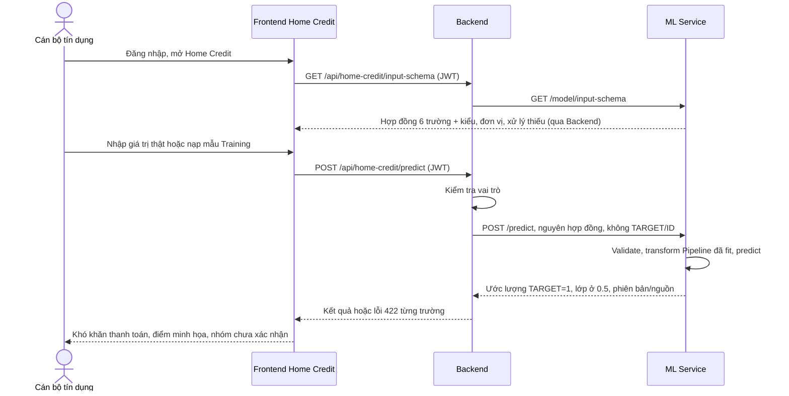

# Sequence diagram: dự đoán Home Credit

Luồng mới không ghi vào lịch sử kết quả mô phỏng có nghĩa default/repayment khác.
Hồ sơ cũ thiếu đầu vào tương đương nhận 422 khi gọi chấm điểm; lịch sử vẫn đọc được.
Không gọi fit, CV, chọn mô hình hay đánh giá Test trong quá trình dự đoán.
